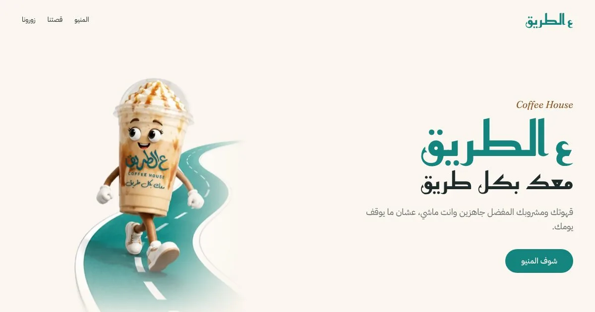

# Al Tareeq Coffee House — Landing Page

A coffee shop landing page with soft, premium motion.

**Live:** [altareeq-iota.vercel.app](https://altareeq-iota.vercel.app) · Part of my [portfolio](https://aya-khamaysa-portfolio.vercel.app)



## Highlights

- **Word-by-word hero** animation.
- **Floating mascot** and scroll reveals.
- **Menu filtered by category.**
- Opening hours and contact, Arabic and mobile first.

## Built with

React · Framer Motion · Tailwind CSS · Vite

## Run locally

```bash
npm install
npm run dev
```

## Use it for a new café
- Info, hours and menu: `src/data/cafe.js`
- Colors and fonts: `src/index.css`

---

Designed & built by **Aya Khamaysa** · [Portfolio](https://aya-khamaysa-portfolio.vercel.app) · [LinkedIn](https://www.linkedin.com/in/ayakhamaysa) · [One Click](https://www.instagram.com/oneclick.ps)
